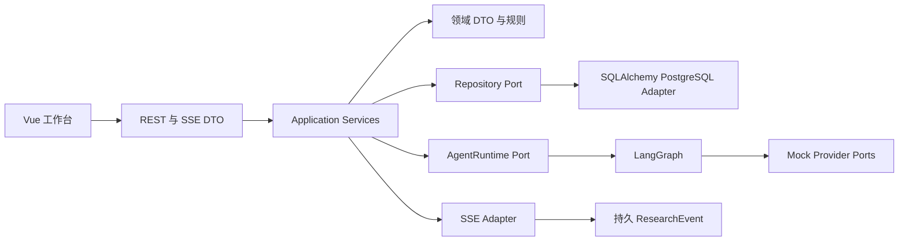

# Architecture Spine — DeepResearch 阶段 A

## Design Paradigm

模块化单体，以 Ports and Adapters 隔离 LangGraph、持久化和 Provider。Frontend 只依赖 REST/OpenAPI 与 SSE 公共契约。

## Invariants & Rules

### AD-1 — 契约先于实现 [ADOPTED]

- **Binds:** FR-1–FR-14
- **Prevents:** 前后端和节点对领域字段产生不同解释。
- **Rule:** Pydantic/OpenAPI schema 是 HTTP DTO 的唯一权威；事件由 ResearchEvent 构造；图内部状态不可直接发送到 UI。

### AD-2 — Mock 与 Provider 由端口隔离 [ADOPTED]

- **Binds:** FR-4–FR-6, FR-11
- **Prevents:** 供应商 SDK 渗入领域层或阶段 A 调用真实服务。
- **Rule:** LLMProvider、WebSearchProvider、KnowledgeProvider、AgentRuntime 与 ReportRenderer 使用协议；阶段 A 仅注入 Mock implementations，不安装真实 Provider SDK。

### AD-3 — Run 状态和事件原子持久化 [ADOPTED]

- **Binds:** FR-3, FR-6–FR-10
- **Prevents:** UI 收到无持久记录的状态，或并发 Scout 事件越过终态。
- **Rule:** PostgreSQL 事务持久化状态与事件；Run 行分配单调事件序号，非终态事件不得占用预留终态槽。

### AD-4 — 有界可取消工作流 [ADOPTED]

- **Binds:** FR-4–FR-7
- **Prevents:** 无限循环、资源失控和取消后仍报告成功。
- **Rule:** Reflect ≤1、Scout calls ≤3、并发 ≤2、运行 ≤120 秒、事件 ≤100；工作流仅依赖固定 fixtures；终态只能写一次。

### AD-5 — 同一运行内引用 [ADOPTED]

- **Binds:** FR-8
- **Prevents:** 报告引用另一任务的证据或挂空 marker。
- **Rule:** Citation.run_id 必须等于 Evidence.run_id；每节 body marker ID 集合必须等于 citation_ids，否则不持久化 Report。

### AD-6 — 本机安全边界 [ADOPTED]

- **Binds:** all
- **Prevents:** 未认证服务、凭据泄露或非预期网络暴露。
- **Rule:** API 绑定 127.0.0.1；Compose 数据库端口绑定 127.0.0.1；不接受浏览器密钥，不发送私有推理或异常堆栈。

## Consistency Conventions

| Concern | Convention |
|---|---|
| Naming | UUID run_id、evidence_id、citation_id；枚举用小写 snake_case |
| Data & formats | ISO-8601 UTC timestamp；JSON error envelope；事件有 run 内整数序号 |
| State & errors | 状态与事件同事务；错误公开稳定 code、message、retryable |
| Providers | mode=mock、fixture=true；tokens_used=null |
| UI | Web/Local/Mock 使用一致标签，文本和图标表达状态 |

## Dependency Direction



## Stack

| Name | Version |
|---|---|
| Python | 3.14.x local, 3.12+ project target |
| FastAPI | 0.141.1 |
| LangGraph | 1.2.12 |
| SQLAlchemy | 2.0.54 |
| PostgreSQL | 18.6 |
| Vue | 3.5.43 |
| Vite | 8.3.0 |
| Pinia | 4.0.3 |
| Vue Router | 5.3.1 |
| Vitest | 5.0.1 |
| Node.js | 24.13.0 local |

## Structural Seed

```text
deepresearch/
  backend/       Python API, domain, graph, adapters and migrations
  frontend/      Vue single-page workbench
  tests/         backend and frontend acceptance
  design-system/ UI token source and page overrides
  _bmad-output/  approved BMM planning and implementation artifacts
```

## Capability → Architecture Map

| Capability / Area | Lives in | Governed by |
|---|---|---|
| Inputs, run DTOs, public errors | backend/domain and backend/api | AD-1, AD-6 |
| Run lifecycle, cancel and budgets | backend/application and backend/runtime | AD-3, AD-4 |
| Graph, Scout, mock fixtures | backend/runtime and backend/providers | AD-2, AD-4 |
| Persistence, sequence, keyset history | backend/persistence | AD-3 |
| Citation and report validation | backend/domain and backend/application | AD-5 |
| UI pages and SSE projection | frontend/src | AD-1, AD-6 |

## Deferred

LangGraph checkpoint recovery, multiple API workers, external LLM/search/knowledge providers, database deployment beyond localhost, authentication and production operations belong to future reviewed phases.
